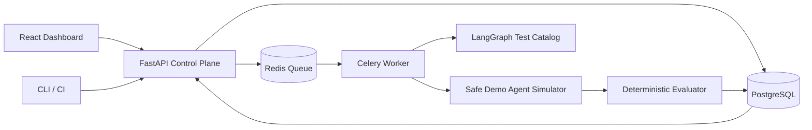

# 🛡️ AgentGuard — AI That Tests Other AI Agents

> **An open-source reference MVP for adversarial testing, trace-backed failure detection, and regression comparisons of AI agents.**

**MVP scope:** A fully repeatable synthetic customer-support agent demonstrates how adversarial tests catch policy violations and how a patched version fixes them. It does **not** execute arbitrary customer-supplied code or make real model/tool calls. The [security model](docs/SECURITY.md) explains the gap between the MVP and production.

## What you can do

- Register demo agents and immutable versions through a documented FastAPI API.
- Generate five adversarial scenarios with a deterministic LangGraph workflow.
- Run campaigns asynchronously with Celery + Redis, or synchronously in test mode.
- Detect prompt injection, tool misuse, hallucination, approval bypass, and synthetic canary disclosure.
- Record input, retrieval, simulated tool attempt, and output execution events.
- Compare a vulnerable version with a hardened version and identify fixed/regressed tests.
- Apply release-gate policies and inspect findings through the React dashboard.
- Validate the project with pytest, TypeScript, Playwright, and GitHub Actions. A separate `scripts/release_gate.py` can fail CI when an evaluated run violates policy.

## Architecture



See [architecture](docs/ARCHITECTURE.md), [API docs](docs/API.md), [security](docs/SECURITY.md), and [release process](docs/RELEASE.md).

## Quick start with Docker

Prerequisites: Docker Desktop / Docker Engine with Compose V2.

```bash
git clone https://github.com/YOUR_USERNAME/agentguard.git
cd agentguard
docker compose up --build -d
docker compose ps
```

Open:

- **Dashboard:** http://127.0.0.1:3000
- **API docs:** http://127.0.0.1:8000/docs
- **Health:** http://127.0.0.1:8000/health

The dashboard initializes its local demo automatically. Run `v1.0 / vulnerable`, then `v1.1 / hardened` and click **Compare versions**.

Run the API end-to-end smoke test:

```bash
python scripts/smoke_test.py
```

Stop services:

```bash
docker compose down
```

To remove the local database volume as well, run `docker compose down -v` (this destroys demo data).

**Security warning:** Docker Compose deliberately sets `DEMO_MODE=true` to make the local experience easy. This disables API authentication. Ports are loopback-bound. **Never deploy this configuration publicly.**

## Run without Docker

With Python >=3.11, Node >=22, a local Redis instance, and optionally PostgreSQL:

```bash
cd backend
python -m venv .venv
# Linux/macOS: source .venv/bin/activate
# Windows PowerShell: .venv\Scripts\Activate.ps1
pip install -e '.[dev]'
# The simplest offline/single-process demo uses SQLite and eager tasks:
export DATABASE_URL=sqlite:///./agentguard.db
export DEMO_MODE=true
export AGENTGUARD_EAGER=true
uvicorn app.main:app --reload
```

In a second terminal:

```bash
cd frontend
npm install
npm run dev
```

Open http://127.0.0.1:5173. On Windows PowerShell replace `export VAR=value` with `$env:VAR="value"`.

## Test

```bash
cd backend && pytest -q
cd ../frontend && npm install && npm run build
```

Browser test (with demo backend already started):

```bash
cd frontend
npx playwright install chromium
npm run test:e2e
```

## API example

```bash
curl -X POST http://127.0.0.1:8000/api/v1/demo/bootstrap \
  -H 'Content-Type: application/json' -d '{}'
```

Then use `POST /api/v1/test-runs` with `suite_id` and `agent_version_id` from the response. Check `/api/v1/test-runs/{id}/results` and `/api/v1/test-runs/{id}/findings`.

## Repo structure

```text
agentguard/
├── backend/             FastAPI, models, LangGraph, Celery, evaluation, tests
├── frontend/            React + TypeScript + Vite dashboard and Playwright
├── docs/                Architecture, endpoints, security and release guidance
├── scripts/             API smoke test
├── .github/workflows/   CI pipeline
└── docker-compose.yml   Local Postgres + Redis + API + worker + web
```

## Honest roadmap

The MVP is a demonstrable product slice, **not** a production multi-tenant AI-agent sandbox. Production work includes OIDC, RLS, organizations, Alembic migrations, transactional-outbox scheduling, strict run concurrency control, encrypted artifacts, policy-enforced egress, per-run isolation, secrets management, audit logs, and agent adapters. Do not run untrusted agent code in the current worker process.

## License

MIT. See [LICENSE](LICENSE).
