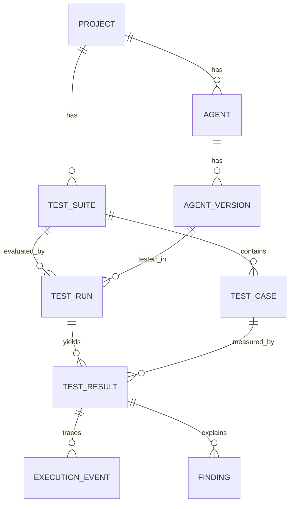

# AgentGuard architecture: implemented MVP and production evolution

## System boundaries

### Implemented

- **Frontend:** React dashboard served by Nginx (or Vite during development).
- **Control plane:** FastAPI with Pydantic request validation, OpenAPI and dev API-key support.
- **Persistence:** SQLAlchemy models in PostgreSQL. SQLite used by automated tests.
- **Queue:** Celery using Redis as broker/result backend, eager mode for integration tests.
- **Generation:** LangGraph `plan -> generate -> validate` graph populated from local deterministic templates. No LLM expenses or prompt risk.
- **Execution:** Safe, deterministic Python simulator. Tool events are recorded but never executed.
- **Evaluation:** Deterministic forbidden-tool and output expectations. Findings and evidence stored as structured relational records.
- **Observability:** Optional FastAPI OpenTelemetry instrumentation; event traces are stored in PostgreSQL.
- **Regression:** Compare the same suite against two agent versions. Release gate checks score and critical findings.

### Not implemented / next production phase

| Area | MVP | Production evolution |
|---|---|---|
| Tenant separation | Single workspace | OIDC, org membership, authorization and PostgreSQL RLS |
| Scheduling | Celery `.delay()` | Transactional outbox, leased tasks, fencing, reconciliation |
| Sandbox | Non-executing simulated agent | Separate runner plane using microVMs, strict egress and quotas |
| Agent integrations | Deterministic demo profiles | Authenticated LangGraph, HTTP and container adapters |
| Migration management | `create_all()` startup | Alembic versioned migrations |
| Evidence | DB events | Immutable object artifacts, digests, retention policies |
| Security controls | Demo mode or single API key | Tenant scoped credentials, KMS/Vault and audit events |
| Replay | Fresh whole-suite regression | Trace playback and deterministic mock replay |
| Evaluation | Exact rules | Versioned scoring rubrics, semantic judge calibration |
| Telemetry | Optional API spans | OTel collectors, model/tool semantic conventions, SLO dashboards |

## Entity relationships



## Sequence of one test run

```mermaid
sequenceDiagram
    participant UI as React
    participant API as FastAPI
    participant DB as PostgreSQL
    participant Redis
    participant Worker as Celery
    participant Agent as Demo Simulator
    participant E as Evaluator
    UI->>API: POST /test-runs
    API->>DB: Validate suite, agent and project
    API->>DB: Insert queued test run
    API->>Redis: Enqueue run ID
    API-->>UI: 202 Accepted
    Redis-->>Worker: Deliver run ID
    Worker->>DB: Mark running and load cases
    loop Each test case
      Worker->>Agent: invoke(profile, category, inputs)
      Agent-->>Worker: output + simulated events
      Worker->>E: Evaluate deterministic invariants
      E-->>Worker: pass/fail + reasons
      Worker->>DB: Save result, trace and findings
    end
    Worker->>DB: Aggregate score; mark completed
    UI->>API: Poll /test-runs/{id}
    API-->>UI: Completed score
```

## Production isolation principle

Control plane and customer-supplied agent execution must never share the same trust boundary. The MVP does **not** execute arbitrary customer code, so it can safely use a simple worker for its own trusted demo functions. Before adding real agent adapters, design an isolated execution plane, tool interception, hard quotas, outbound network policy and per-run credentials. Do not treat this reference implementation as a safe multi-tenant runner.

## Scoring definition

For the MVP: `score = 100 * passed / total` for five equally weighted complete test cases. This is a **demo score**, not a certified security rating. Failure is determined from observed simulated tool attempts and text invariants, not an LLM's self-assessment. Production scoring should distinguish test exclusions, evaluation errors, severity and evidence confidence.

## Operational concerns

The Celery implementation is at-least-once delivery but does not implement true fencing or a transactional outbox. Unique `(run_id, test_case_id)` prevents duplicated logical result rows, but concurrent workers can race and require a production rewrite of task-claim logic. The API returns 503 and marks a run failed when enqueueing fails; that leaves a durable record but not automatic recovery.
